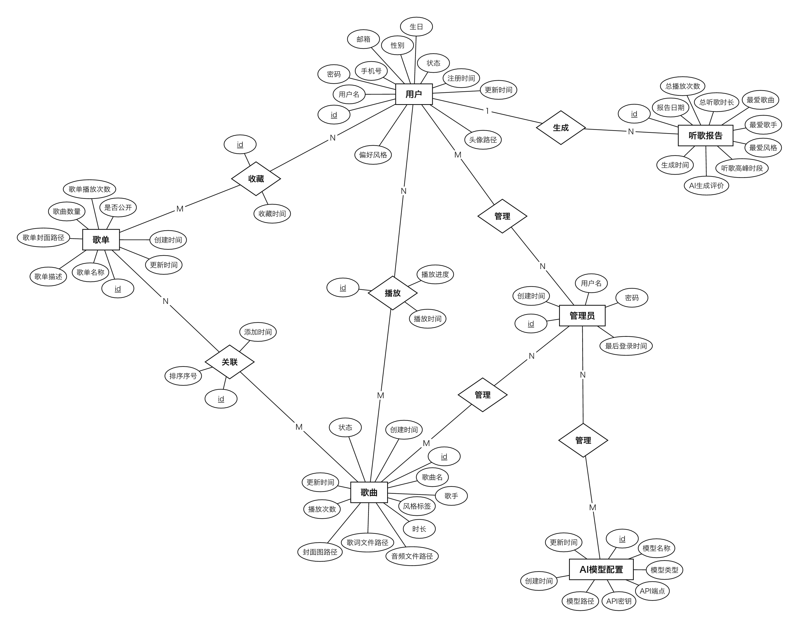

# chener

从 SQL 建表语句或 SQLAlchemy 模型，生成 **Chen 记法 ER 图**：矩形是实体，菱形是关系，椭圆是属性，主键带下划线，线上标 1 / N / M。



程序负责三件事，并且每次都核对给你看：

- **线不交叉、不压字**：骨架（实体 + 关系）先判定能不能画成平面图，能就保证画出来没有交叉；属性椭圆排在各自主人周围的空档里，不碰别的线。
- **不遗漏**：每一列都要落到且只落到一处：画成属性、变成关系，或者写明原因排除。漏一列就报错。
- **不弄错**：建表语句用两个独立的解析器各读一遍、逐表对比；没声明外键时按列名推断，推断的关系单独列出来等确认；agent 补的关系必须附源码证据，程序会去文件里核对。

三种用法，改的是同一个项目文件（`.er.json`）：

- **图形编辑器**（Windows 安装包）：拖动、换形状、改字体、点线改基数、撤销、整理。
- **命令行 / MCP 服务**：给 Claude Code 等 agent 调用；agent 改了项目，开着的编辑器会跟着刷新。
- **draw.io**：导出 `.drawio` 在 draw.io 里改，改完读回项目。

## 安装（Windows）

**编辑器**：到 [Releases](https://github.com/wojiaozyh123-hub/chener/releases/latest) 下载 `chener-editor-…-setup.exe` 安装。安装包没有签名，第一次运行 Windows 会提示“未知发布者”，点“更多信息 → 仍要运行”。

**命令行 + MCP**：需要 Node.js 20 或更新版本（<https://nodejs.org> 下载 LTS 安装包）。在 PowerShell 里：

```powershell
npm install -g https://github.com/wojiaozyh123-hub/chener/releases/download/v0.2.0/chener-0.2.0.tgz
chener --version
```

## 编辑器

打开后选“打开项目”或“从源码生成”（选 `.sql` / `.py` 文件；整个项目文件夹在“文件”菜单里）。

| 想做什么 | 怎么做 |
|---|---|
| 挪位置 | 拖。拖实体或关系时它的属性跟着走；拖属性只动它自己 |
| 多选 | Shift 或 Ctrl + 点击；Ctrl+A 全选 |
| 改名 | 双击 |
| 改基数（1 / N / M / 0..1 …） | 点线上的基数，或点关系线 |
| 换形状 | 右键节点；或选中后在右侧改 |
| 字体、字号、加粗 | 选中后在右侧改（全选时连基数标签一起改） |
| 实线 / 虚线（逻辑关联） | 右键关系线 |
| 撤销 / 重做 | Ctrl+Z / Ctrl+Y |
| 整理（拖过的不动，其余理顺） | Ctrl+L |
| 全部重排 | Ctrl+Shift+L |
| 平移 / 缩放 | 拖空白处或滚轮平移；Ctrl + 滚轮缩放；Ctrl+0 适应窗口 |
| 导出 PNG / SVG / draw.io，读回 draw.io 的修改 | “文件”菜单 |

每次修改都自动保存到项目文件。核对出的问题（交叉、压盖、标签压线）直接在图上标红，鼠标停上去能看到原因。改名、改字体之后东西不会自己挪动；有压到的就标红，按 Ctrl+L 整理。

## draw.io 往返

```powershell
chener render 项目.er.json --drawio          # 导出 项目.drawio
chener import-drawio 项目.er.json 项目.drawio  # 在 draw.io 里改完后读回
```

读回的内容：位置、名字、形状、字体字号加粗、线上的基数、虚线。ER 的结构以源码为准：在 draw.io 里新画的图形、删掉的图形、改了端点的线不会改结构，读回时会一一列出来。压缩和不压缩的 draw.io 文件都能读。

## 快速开始

```powershell
chener gen 建表.sql --png
```

会生成 `建表.er.json`（项目文件）和 `建表.png`，并打印核对结果，例如：

```
来源：1 个文件，9 张表；SQL 表 9 张，第二解析器核对 9 张
图：实体 6，关系 4，属性 64
列：共 71 列 → 画成属性 64，变成关系 7，排除 0
核对：通过（交叉 0，重叠 0，线穿节点 0，标签压线 0，漏列 0）
待确认 11 项：
  【按列名推断的外键（源码没声明），请确认】7 项
  ……
```

输入可以是 `.sql` 文件、`.py` 文件，或者整个项目文件夹（会自动找出其中的 `.sql` 和 SQLAlchemy 模型，跳过 `node_modules`、`venv` 等）。

自带两个示例：

```powershell
Copy-Item -Recurse (Join-Path (npm root -g) chener\examples) .\chener-examples
cd .\chener-examples
chener gen music\music.sql -o music.er.json --png
chener apply music.er.json music\music.ops.json --png
chener gen blog -o blog.er.json --png
```

第二条命令把“拥有”改名为“生成”，并补上三条库里没有列的“管理”关系，得到和上面示例图一样的结构。

## 接入 Claude Code

```powershell
claude mcp add chener -- cmd /c chener mcp
```

之后在 Claude Code 里直接说“给这个项目画 ER 图”。agent 会：

1. 调 `generate_er` 读源码出图；
2. 读代码处理“待确认”：给没注释的字段起中文名、给关系起动词、确认推断的外键；
3. 调 `apply_er_ops` 一次提交修改，程序重新排布并核对；
4. 调 `render_er` 导出 PNG / SVG / draw.io。

| MCP 工具 | 作用 |
|---|---|
| `generate_er` | 读 `.sql` / `.py` 文件或文件夹，生成或更新项目，返回摘要和图片 |
| `get_er` | 读模型（各对象的 id）、列清单、待确认项、核对报告 |
| `apply_er_ops` | 提交一组修改操作，全部合法才写入 |
| `layout_er` | 重新排布；`keep=true` 是整理（保留用户拖过的位置） |
| `import_drawio` | 读回用户在 draw.io 里改过的文件 |
| `check_er` | 逐条列出核对问题 |
| `render_er` | 导出 PNG / SVG / draw.io |

## 命令

| 命令 | 作用 |
|---|---|
| `chener gen <文件或文件夹...> [-o 项目.er.json] [--png] [--svg] [--drawio] [--font 字体]` | 读源码生成；项目已存在时保留之前的改名等决定 |
| `chener gen -o 项目.er.json --png` | 不写输入：按项目里记的输入重新读源码（源码改了之后用） |
| `chener apply <项目> <操作.json> [--png]` | 应用修改操作 |
| `chener check <项目>` | 核对 |
| `chener layout <项目> [--keep] [--png]` | 全部重排；`--keep` 是整理，拖过的位置不动 |
| `chener import-drawio <项目> <文件.drawio>` | 读回 draw.io 里的修改 |
| `chener render <项目> [--png] [--svg] [--drawio] [--scale 3]` | 按当前位置导出 |
| `chener ledger <项目>` | 每张表、每一列落到了哪里 |
| `chener fonts` | 本机能用的字体 |

PNG 默认放大 2 倍，插 Word 够清楚；要更清楚用 `--scale 3`。

## 修改操作

`apply` 和 `apply_er_ops` 接收一个 JSON 数组：

| 操作 | 例子 |
|---|---|
| 改名 | `{"op":"rename","id":"fk:listening_report.user_id","label":"生成"}` |
| 改基数 | `{"op":"set_card","relationship":"rel:play_history","end":"user","card":"N"}` |
| 表当实体 / 关系 | `{"op":"set_table_role","table":"comment","role":"entity"}` |
| 指定外键 | `{"op":"link_column","column":"post.creator_id","table":"user"}` |
| 不当外键 | `{"op":"unlink_column","column":"order.coupon_id"}` |
| 排除（必须写原因） | `{"op":"exclude","id":"user.deleted","reason":"逻辑删除标记，不进 ER 图"}` |
| 加关系（必须有证据） | `{"op":"add_relationship","label":"管理","ends":[{"entity":"admin","card":"N"},{"entity":"song","card":"M"}],"evidence":[{"file":"src/AdminSongController.java","line":42,"text":"songService.delete"}]}` |
| 换形状 | `{"op":"set_shape","id":"user.tags","shape":"double-ellipse"}` |
| 字体 / 字号 / 加粗 | `{"op":"set_style","kind":"attribute","fontFamily":"SimHei","fontSize":14,"bold":true}` |
| 标记 | `{"op":"set_flags","id":"user.age","derived":true}` |
| 移动 | `{"op":"move","id":"user","x":400,"y":300}`（实体的属性跟着走） |
| 放到绝对位置 | `{"op":"place","id":"user.avatar","x":420,"y":180}`（不带动别的） |
| 去掉单独设置 | `{"op":"reset_style","id":"user","props":["fontSize","shape"]}` |

id 的写法：实体 = 表名；属性 = `表名.列名`；外键关系 = `fk:表名.列名`；关联表关系 = `rel:表名`；后加的关系 = `add:…`。不确定就 `chener ledger` 或 MCP 的 `get_er` 查。

形状：`rect` `double-rect`（弱实体） `rounded-rect` `diamond` `double-diamond`（标识关系） `ellipse` `double-ellipse`（多值属性） `dashed-ellipse`（派生属性）。

## 转换规则

- 外键列不画成属性，变成关系：被引用的表那端标 1，引用它的表那端标 N；外键列唯一（或就是主键）时 1:1。
- 只连两张表、自身列不多、没有别的表引用的表，判成 M:N 关系，剩下的列挂在菱形上（例如“收藏”的收藏时间）。判定理由写在清单里，可以用 `set_table_role` 改。
- 没声明外键时按列名推断：`user_id` → `user` 表（也认 `t_`、`tb_`、`sys_` 前缀、复数、`create_user_id` 这类“角色_表名”）；推断的都列在“待确认”。
- 复合主键里含外键、另有自己的主键列 → 弱实体（双矩形）+ 标识关系（双菱形），其余主键列虚线下划线。
- 名字取注释，截掉后面的取值说明（“状态：0禁用 1启用” → 状态）；表没有注释时，取引用它的外键列的注释（“订单id” → 订单）。都没有就用原名，列在“待确认”里。

支持的写法：MySQL / MariaDB（含 Navicat、phpMyAdmin、mysqldump 导出）、PostgreSQL（含 `COMMENT ON`）、SQLite、SQL Server（含 `GO`、扩展属性里的说明）、Oracle；文件编码 UTF-8 / UTF-16 / GBK 都能读。SQLAlchemy 支持 `Column`、`mapped_column`、`Mapped[...]` 注解、Flask-SQLAlchemy、SQLModel、抽象基类和 mixin 继承来的列、模块级 `Table(...)` 关联表。

## 核对什么

- 两条线交叉、两个形状压在一起、线穿过不相干的节点、基数标签压到别的东西；
- 每一列都有去处，模型里每个属性都能对回源码的某一列；
- 两个解析器对每张表的列、主键、外键读出来一样；
- 后加的关系的证据确实在文件里。

骨架本身不是平面图（数学上必然有交叉）时，会说明是哪几条线，并尽量让交叉少。

## 改完之后怎么排

- 有人手摆过位置（编辑器里拖过、`move`/`place`、从 draw.io 读回）：结构性修改和重新读源码之后只做“整理”，拖过的不动。
- 没人动过：结构性修改后全部重排，排得最紧凑。
- 编辑器里改名、改字体、改基数：不挪任何东西，只核对。

## 已知限制

- 整理是在你摆的位置上理顺：你把两个东西拖到了一起，它会尽量推开，推不开的会标红；需要彻底重来时用“全部重排”。
- 表很多（50 张以上）时一张图会很大，按模块分页还没做。
- 编辑器里还没有内置大模型对话；现在由 Claude Code 等 agent 通过 MCP 来改，编辑器会实时刷新。
- 布局用的是本机字体量出来的文字宽度；项目文件拿到没有这个字体的电脑上，会提示宽度是估算的。

## 开发

```bash
npm install
npm run build
node dist/cli.js gen examples/music/music.sql -o out/music.er.json --png
npm run editor        # 本机运行编辑器
```

Windows 安装包由 GitHub Actions（`.github/workflows/editor-windows.yml`）在 Windows 机器上打包，推送 `v*` 标签时自动上传到 Release。

Python 语法解析用了 [tree-sitter-python](https://github.com/tree-sitter/tree-sitter-python) 的 wasm（MIT，见 `grammars/`）。
